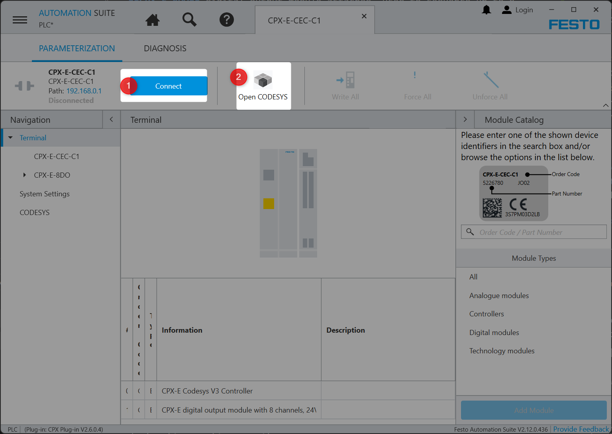

# Inoculant-FestoPLC

CODESYS (Festo Automation Suite) program for a Festo **CPX-E-CEC-C1** controller with a
**CPX-E-8DO** digital output module attached, used to sequence up to 8 solenoid valves
(inoculant dosing application).

## How to upload (download) a new program
1. Open `Festo Automation Suite`. Select the PLC and click `Open PPlugin`

2. Connect and Open Codesys

3. Paste the code. There are two code sections, 1. The `Variable declaration` and 2. The `Body`. Make sure you paste each part in the right place

4. Login to the device. You will be prompted to enter a password. (tips Guemes Lea)

5. Start the program and Create a boot application.
Boot application will make sure the program starts automatically when the device is powered on.

You are done!

## What this does

`PLC_PRG.st` cycles through the enabled valves one at a time, keeping each
valve open for a configurable amount of time before moving on to the next enabled valve,
then looping back to the first one.

- Up to 8 valves are supported, mapped to the 8 bits of the `byValves : BYTE` output
  (bit 0 = valve 1, bit 1 = valve 2, ... bit 7 = valve 8), which is wired to the
  CPX-E-8DO digital outputs.
- Each valve has its own configurable open time (`tValveN_Time`).
- Setting a valve's time to `T#0S` skips that valve entirely (it will not open) — this
  is also how you enable/disable a valve, so there is only one parameter per valve.
- Configuration is done via named variables at the top of the declaration section, so it
  can be adjusted without needing to understand or edit the sequencing logic itself.

## Files

- `PLC_PRG.st` — Structured Text (ST) source for the CODESYS program.
  The file contains two parts, separated by a `// BODY` marker:
  - Declaration part (top): variables, including the configuration section.
  - Body part (bottom): the sequencing logic.

## Status

Work in progress. Detailed setup/deployment instructions (how to import this into
Festo Automation Suite / CODESYS, wiring, and how to make it start automatically on
power-up) will be added later.
