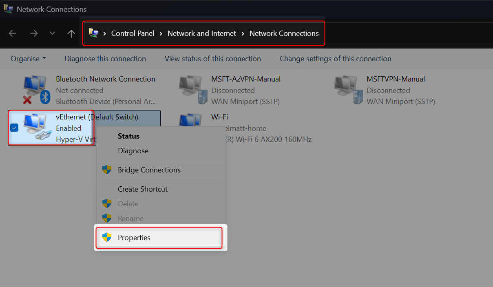
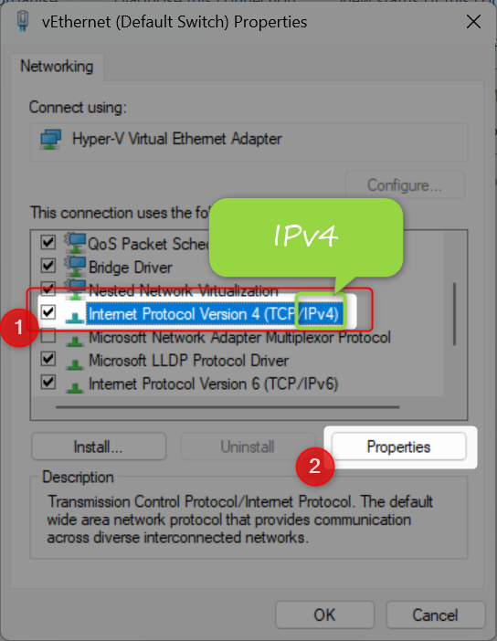
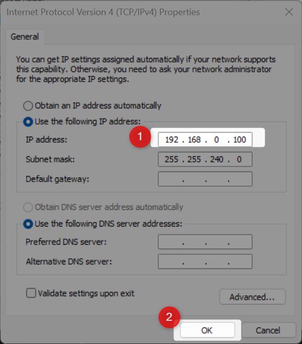
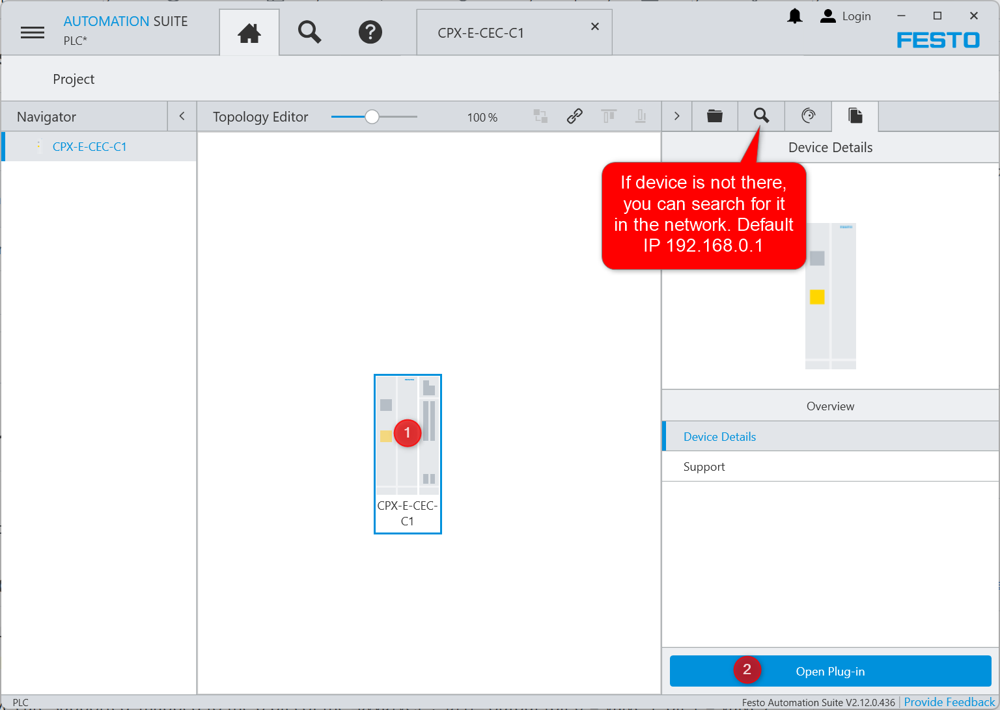
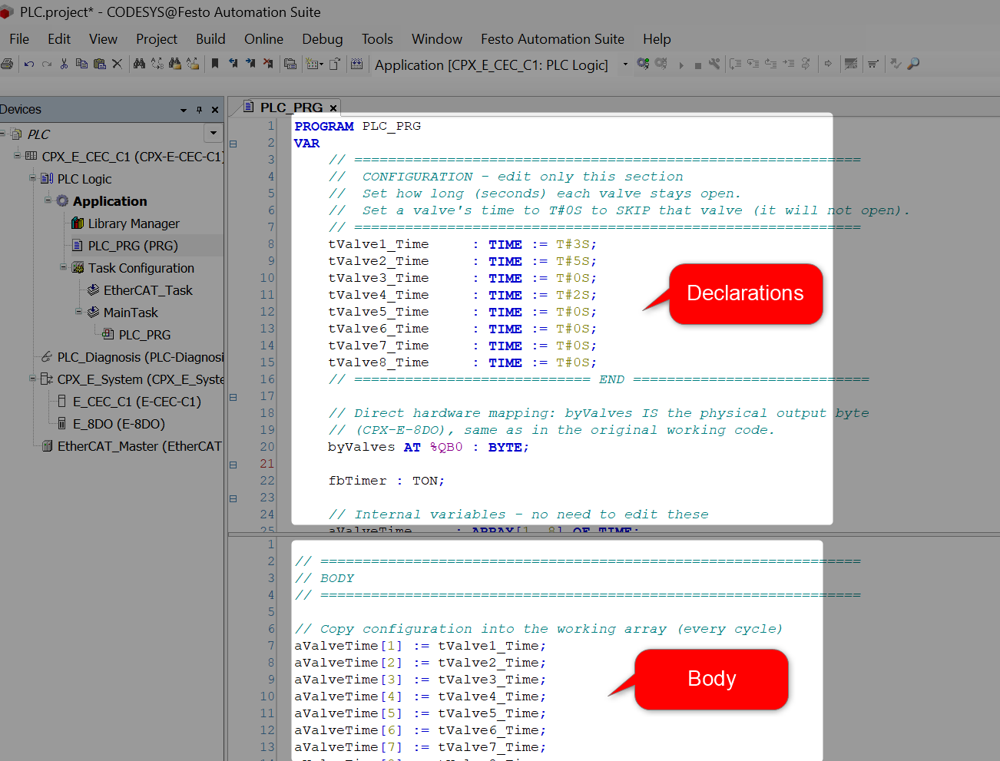

# Inoculant-FestoPLC

CODESYS (Festo Automation Suite) program for a Festo **CPX-E-CEC-C1** controller with a
**CPX-E-8DO** digital output module attached, used to sequence up to 8 solenoid valves
(inoculant dosing application).

## How to upload (download) a new program
1. Connect the PC to the PLC network. In Windows, open **Control Panel > Network and Internet > Network Connections**.
Right-click the network adapter connected to the PLC and select **Properties**.
Use your PLC-connected adapter; its name may differ from the one shown.

2. Select **Internet Protocol Version 4 (TCP/IPv4)** and click **Properties**.

3. Select **Use the following IP address**. The screenshot uses PC address **192.168.0.100**
and subnet mask **255.255.240.0**. Use an unused PC address in the PLC's subnet,
not the PLC's own address. For a direct PLC connection, the gateway and DNS fields
can remain blank. Click **OK** to apply, then close the adapter properties.

4. Open `Festo Automation Suite`. Select the PLC and click `Open PPlugin`

5. Connect and Open Codesys

6. Paste the code. There are two code sections, 1. The `Variable declaration` and 2. The `Body`. Make sure you paste each part in the right place

7. Login to the device. You will be prompted to enter a password. (tips Guemes Lea)
If CODESYS reports that the application has changed, select **Login with download**,
not **Login with online change**. An online change keeps the running variable values,
so new times/valves in `aStepTime`/`aStepValves` are not applied. After an online change,
use **Online > Reset Cold** to load them instead. A download or reset stops the application.

8. Start the program and Create a boot application.
Boot application will make sure the program starts automatically when the device is powered on.
Without a new boot application, the previous program returns after a power cycle.

You are done!

## What this does

`PLC_PRG.st` cycles through 4 configurable steps, skipping any disabled ones. Each step opens a selected group
of valves together for a configurable duration. A single output-byte assignment
switches directly to the next group, then the sequence loops back to the first
enabled step.

The default sequence runs each pump/valve pair together for **30 seconds**:
**1+8**, **2+7**, **3+6**, **4+5**, then repeats.

- Up to 8 valves are supported, mapped to the 8 bits of the `byValves : BYTE` output
  (bit 0 = valve 1, bit 1 = valve 2, ... bit 7 = valve 8), which is wired to the
  CPX-E-8DO digital outputs.
- Each step has a valve mask (`aStepValves[N]`) and duration (`aStepTime[N]`),
  initialized directly in the two arrays.
  In a binary mask, the bits from left to right represent valves **8 7 6 5 4 3 2 1**.
  For example, `2#10000001` selects valves 1+8, and `2#01000010` selects valves 2+7.
- A single set bit runs one valve; multiple set bits run valves in parallel.
  A valve may appear in more than one step.
- Setting a step's time to `T#0S` or its mask to `2#00000000` skips that step.
  If all steps are disabled, all valves remain closed.
- At each transition, the outgoing valves close and the incoming valves open in
  the same output update, with no intentional all-off gap. Valves shared by
  consecutive steps remain on.
- To add or remove steps, update `cStepCount` and the entries in both array
  initializers. The sequencing logic needs no changes.

## Files

- `PLC_PRG.st` — Structured Text (ST) source for the CODESYS program.
  The file contains two parts, separated by a `// BODY` marker:
  - Declaration part (top): variables, including the configuration section.
  - Body part (bottom): the sequencing logic.

## Status

Work in progress. Detailed setup/deployment instructions (how to import this into
Festo Automation Suite / CODESYS, wiring, and how to make it start automatically on
power-up) will be added later.
